  <picture>
    <source media="(prefers-color-scheme: dark)" srcset="./assets/header-dark.svg">
    <source media="(prefers-color-scheme: light)" srcset="./assets/header-light.svg">
    
  </picture>

    

  

    
    
    
  

---

## About

I build full-stack web and mobile systems with **Java / Spring Boot**, **React / Next.js**, and **Kotlin**, alongside **GenAI & NLP** workflows. Outside shipping products, I teach IT at STI College Fairview and compete in collegiate hackathons.

- **IT Faculty Teacher** — STI College Fairview (2026)
- **Software Developer Intern (NLP/AI)** — 3 AM Digital Media (2026)
- **Student Assistant (MIS)** — STI College Fairview (2024)
- **BS in Information Technology** — STI College Fairview (2022–2026)

---

## Hackathon Highlights

- **Codefest Cluster Champion (2024–2025)** — Back-to-back regional champion; designed, built, and pitched an end-to-end mobile solution in a 6-hour sprint.
- **Codefest Local Champion (2024–2025)** — Consecutive local titles shipping working mobile apps from scratch in 6 hours.
- **Codefest National Finalist (2024–2025)** — Competed in a 32-hour national mobile architecture marathon without AI assistance.

---

## Featured Projects

### StarWashPH — Laundry Management System
Multi-site operations and real-time tracking platform built as an undergraduate thesis, cutting manual administrative overhead by **40%**.

  
  
  
  

[STARWASH Core](https://github.com/YtterStick/STARWASH) · [Thesis Repository](https://github.com/YtterStick/thesis)

---

### Distribution System — Codefest
Supply chain logistics solution covering routing, inventory flow, and warehouse order scheduling under competitive hackathon constraints.

  
  
  

[View Repository](https://github.com/YtterStick/distribution-system-codefest)

---

### ytter-dev — Developer Portfolio
Personal developer showcase with project case studies and responsive motion design.

  
  
  

[Live Site](https://ytter-dev.vercel.app/) · [View Repository](https://github.com/YtterStick/portfolio)

---

### Long-Quiz — Interactive Assessment App
TypeScript-powered quiz and evaluation platform with streamlined response capture and responsive layout.

  
  
  

[Live Site](https://long-quiz.vercel.app) · [View Repository](https://github.com/YtterStick/Long-Quiz)

---

## Tech Stack

  <picture>
    <source media="(prefers-color-scheme: dark)" srcset="https://skillicons.dev/icons?i=java,spring,ts,js,react,nextjs,tailwind,kotlin,androidstudio,flutter,python,fastapi,dotnet,php,mongodb,postgres,mysql,docker,git,github&perline=10&theme=dark">
    <source media="(prefers-color-scheme: light)" srcset="https://skillicons.dev/icons?i=java,spring,ts,js,react,nextjs,tailwind,kotlin,androidstudio,flutter,python,fastapi,dotnet,php,mongodb,postgres,mysql,docker,git,github&perline=10&theme=light">
    
  </picture>

 

<b>Full breakdown by discipline</b>

 

- **AI & LLMs:** Generative AI, Foundation Models, LLMs, Multimodal AI, Fine-Tuning, Prompt Engineering, Semantic Routing, n8n, Microsoft Copilot Studio, Agent 365, AWS Bedrock Agentcore
- **Backend:** Java, Spring Boot, Spring Security, Spring Data JPA, Hibernate, Maven, Gradle, Node.js, Express, Python, FastAPI, ASP.NET Core, Entity Framework, Laravel PHP, REST APIs
- **Frontend:** React (Vite), Next.js, TypeScript, JavaScript (ES6+), HTML5, CSS3, SASS/SCSS, AJAX, Tailwind CSS
- **Mobile & Desktop:** Android Studio, Kotlin, Java, XML, Flutter, Java Swing
- **Data & DevOps:** MongoDB, PostgreSQL, MySQL, Data Warehousing, Schema Modeling, Docker, Git, GitHub Actions, CI/CD, SAP S/4HANA, Agile/Scrum

---

## GitHub Activity

  

    <picture>
      <source media="(prefers-color-scheme: dark)" srcset="https://github-profile-summary-cards.vercel.app/api/cards/stats?username=YtterStick&theme=github_dark">
      <source media="(prefers-color-scheme: light)" srcset="https://github-profile-summary-cards.vercel.app/api/cards/stats?username=YtterStick&theme=github">
      
    </picture>
    <picture>
      <source media="(prefers-color-scheme: dark)" srcset="https://github-profile-summary-cards.vercel.app/api/cards/repos-per-language?username=YtterStick&theme=github_dark">
      <source media="(prefers-color-scheme: light)" srcset="https://github-profile-summary-cards.vercel.app/api/cards/repos-per-language?username=YtterStick&theme=github">
      
    </picture>
  

  <picture>
    <source media="(prefers-color-scheme: dark)" srcset="https://streak-stats.demolab.com/?user=YtterStick&theme=github-dark-blue&background=0D1117&border=30363D">
    <source media="(prefers-color-scheme: light)" srcset="https://streak-stats.demolab.com/?user=YtterStick&theme=github-light&background=FFFFFF&border=D0D7DE">
    
  </picture>

    

  <picture>
    <source media="(prefers-color-scheme: dark)" srcset="https://raw.githubusercontent.com/YtterStick/YtterStick/output/github-contribution-grid-snake-dark.svg">
    <source media="(prefers-color-scheme: light)" srcset="https://raw.githubusercontent.com/YtterStick/YtterStick/output/github-contribution-grid-snake.svg">
    
  </picture>

