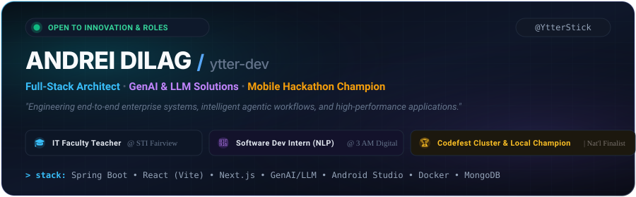

  <!-- Interactive Custom Hero Banner -->
  

    

  <!-- Dynamic Typing Headline -->
  

   

  <!-- Quick Action & Social Badges -->
  

    
    
    
    
  

## 👨‍💻 Executive Summary

> **Results-driven Software Developer & Multi-Award-Winning Hackathon Competitor** with a proven track record architecting full-stack web, desktop, and mobile solutions. Recognized as a **Codefest Local & Cluster Champion** and **National Finalist** (32-hour marathon without AI). Proficient in enterprise backend engineering (**Java, Spring Boot, MongoDB**), modern frontend interfaces (**React, Next.js, Tailwind CSS**), mobile ecosystems (**Android Studio, Kotlin, Flutter**), and frontier intelligence (**GenAI, LLMs, Bedrock Agentcore, n8n, Semantic Routing**).

<table align="center" width="100%">
  <tr>
    <td width="50%" valign="top">
      <h4>🎓 Academic &amp; Roles</h4>
      <ul>
        <li>🎓 <b>BS in Information Technology</b> — STI College Fairview (2022–2026)</li>
        <li>👨‍🏫 <b>IT Faculty Teacher</b> — STI College Fairview (2026)</li>
        <li>🤖 <b>Software Developer Intern (NLP/AI)</b> — 3 AM Digital Media (2026)</li>
        <li>💻 <b>Student Assistantship (MIS)</b> — STI Fairview (2024)</li>
      </ul>
    </td>
    <td width="50%" valign="top">
      <h4>⚡ Core Focus &amp; Passion</h4>
      <ul>
        <li>🏗️ <b>Enterprise Architecture</b>: End-to-end resilient web services &amp; RESTful APIs</li>
        <li>🧠 <b>Agentic AI &amp; LLMs</b>: Prompt engineering, fine-tuning &amp; autonomous workflows</li>
        <li>📱 <b>Mobile Engineering</b>: High-performance native Android &amp; cross-platform apps</li>
        <li>🤝 <b>Mentorship &amp; Teaching</b>: Empowering emerging developers with modern tech</li>
      </ul>
    </td>
  </tr>
</table>

## 🏆 Competitive Hackathon Honors & Accolades

A battle-tested track record under continuous, high-pressure competitive conditions:

<table>
  <thead>
    <tr>
      <th align="center">Award</th>
      <th>Competition</th>
      <th>Timeline</th>
      <th>Key Achievement &amp; Scope</th>
    </tr>
  </thead>
  <tbody>
    <tr>
      <td align="center">🥇 <b>Champion</b></td>
      <td><b>Codefest Cluster Champion</b></td>
      <td>2024 – 2025</td>
      <td>Secured consecutive regional cluster championships. Engineered, styled, and pitched a full end-to-end mobile enterprise software solution within a <b>strict 6-hour high-pressure constraint</b> against top collegiate teams.</td>
    </tr>
    <tr>
      <td align="center">🥇 <b>Champion</b></td>
      <td><b>Codefest Local Champion</b></td>
      <td>2024 – 2025</td>
      <td>Won back-to-back local championship titles by designing and building a fully functional mobile software application from scratch within an <b>intensive 6-hour limit</b>.</td>
    </tr>
    <tr>
      <td align="center">🏅 <b>Finalist</b></td>
      <td><b>Codefest National Entrant &amp; Finalist</b></td>
      <td>2024 – 2025</td>
      <td>Advanced to the national stage to compete among the country's elite developers. Executed a complex mobile architecture during a <b>continuous, grueling 32-hour sprint completely without AI assistance</b>.</td>
    </tr>
  </tbody>
</table>

## 🛠️ Technical Skills & Architecture Stack

  

 

<b>🔍 Detailed Skills Breakdown by Discipline</b>

 

| Discipline | Core Technologies & Frameworks |
|:---|:---|
| **🤖 AI & Large Language Models** | Generative AI (GenAI), Foundation Models, LLMs, Multimodal AI, Fine-Tuning, Prompt Engineering, Semantic Routing, n8n, Microsoft Copilot Studio, Agent 365, AWS Bedrock Agentcore |
| **☕ Backend & Enterprise Systems** | Java, Spring Boot, Spring Security, Spring Data JPA, Hibernate, Maven, Gradle, Node.js, Express, Python, FastAPI, ASP.NET Core, Entity Framework, Laravel PHP, RESTful APIs, End-to-End (e2e) Architecture |
| **🌐 Frontend & Modern Web** | React (Vite), Next.js, TypeScript, JavaScript (ES6+), HTML5, CSS3, SASS/SCSS, AJAX, Tailwind CSS, System Logic Optimization |
| **📱 Mobile & Desktop** | Android Studio, Kotlin, Java (Mobile), XML, Gradle, Flutter, Java Swing |
| **🗄️ Data Modeling & Databases** | MongoDB, PostgreSQL, MySQL, Data Warehousing, Data Mapping, Data Schema Modeling |
| **⚙️ DevOps & Enterprise Tools** | Docker, Git, GitHub Actions, CI/CD Pipelines, SAP S/4HANA, Agile / Scrum Methodologies |

## 🚀 Featured Production & Signature Projects

<table>
  <tr>
    <td width="50%" valign="top">
      <h3>🧺 StarWashPH — Laundry Management</h3>
      
<i>Enterprise Multi-Site Operations &amp; Real-Time Tracking (Thesis Project)</i>

      
Architected a full-stack, end-to-end enterprise platform with a robust <b>Spring Boot Java</b> backend and <b>MongoDB</b> for scalable data management. Built a modern <b>React (Vite) + Tailwind CSS</b> dashboard that reduced manual administrative friction by <b>40%</b>.

      

        
        
        
        
      

      

        📂 <a href="https://github.com/YtterStick/thesis"><b>View Thesis Repo</b></a> • <a href="https://github.com/YtterStick/STARWASH"><b>STARWASH Core</b></a>
      

    </td>
    <td width="50%" valign="top">
      <h3>🚚 Distribution System — Codefest</h3>
      
<i>High-Pressure Hackathon Supply Chain Logistics Solution</i>

      
Engineered under competitive hackathon conditions to solve routing, inventory flow, and warehouse order scheduling with high stability, robust object-oriented architecture, and optimized logic.

      

        
        
        
      

      

        📂 <a href="https://github.com/YtterStick/distribution-system-codefest"><b>View Hackathon Repo</b></a>
      

    </td>
  </tr>
  <tr>
    <td width="50%" valign="top">
      <h3>🌐 Andrei Dev Portfolio (ytter-dev)</h3>
      
<i>Personal Developer Showcase &amp; Interactive Platform</i>

      
Modern, responsive portfolio website featuring dynamic project showcases, smooth motion design, and high-performance client rendering.

      

        
        
        
      

      

        🔗 <a href="https://ytter-dev.vercel.app/"><b>Live Website</b></a> • 📂 <a href="https://github.com/YtterStick/portfolio"><b>Repository</b></a>
      

    </td>
    <td width="50%" valign="top">
      <h3>📝 Long-Quiz Interactive Platform</h3>
      
<i>Dynamic Educational Assessment System</i>

      
Interactive TypeScript-powered testing and evaluation tool designed for streamlined quizzing, real-time response capture, and responsive styling.

      

        
        
        
      

      

        🔗 <a href="https://long-quiz.vercel.app"><b>Live Website</b></a> • 📂 <a href="https://github.com/YtterStick/Long-Quiz"><b>Repository</b></a>
      

    </td>
  </tr>
</table>

## 📊 GitHub Analytics & Contributions

  <table border="0">
    <tr>
      <td align="center" valign="middle">
        
      </td>
      <td align="center" valign="middle">
        
      </td>
    </tr>
  </table>

   

  <!-- GitHub Streak Card -->
  

    

  <!-- Contribution Snake Grid -->
  <picture>
    <source media="(prefers-color-scheme: dark)" srcset="https://raw.githubusercontent.com/YtterStick/YtterStick/output/github-contribution-grid-snake-dark.svg">
    <source media="(prefers-color-scheme: light)" srcset="https://raw.githubusercontent.com/YtterStick/YtterStick/output/github-contribution-grid-snake.svg">
    
  </picture>

## 📬 Connect & Collaborate

I am always interested in discussing enterprise software architecture, full-stack web/mobile projects, GenAI &amp; LLM workflows, and developer education.

  
  &nbsp;
  
  &nbsp;
  

 

  Crafted with passion, caffeine, and precision by <b>Andrei Dilag (@YtterStick)</b> • Quezon City, Philippines

